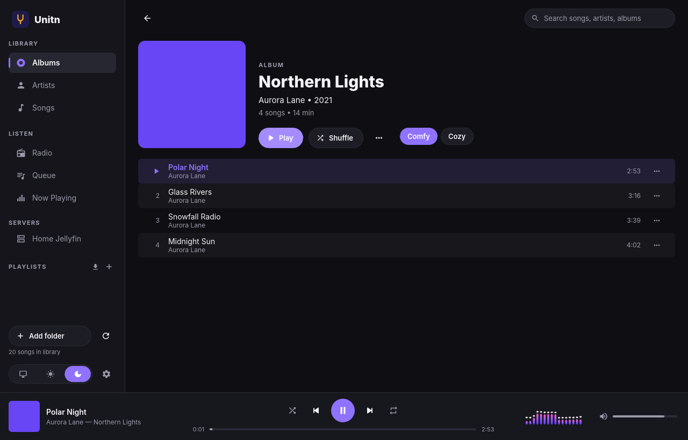
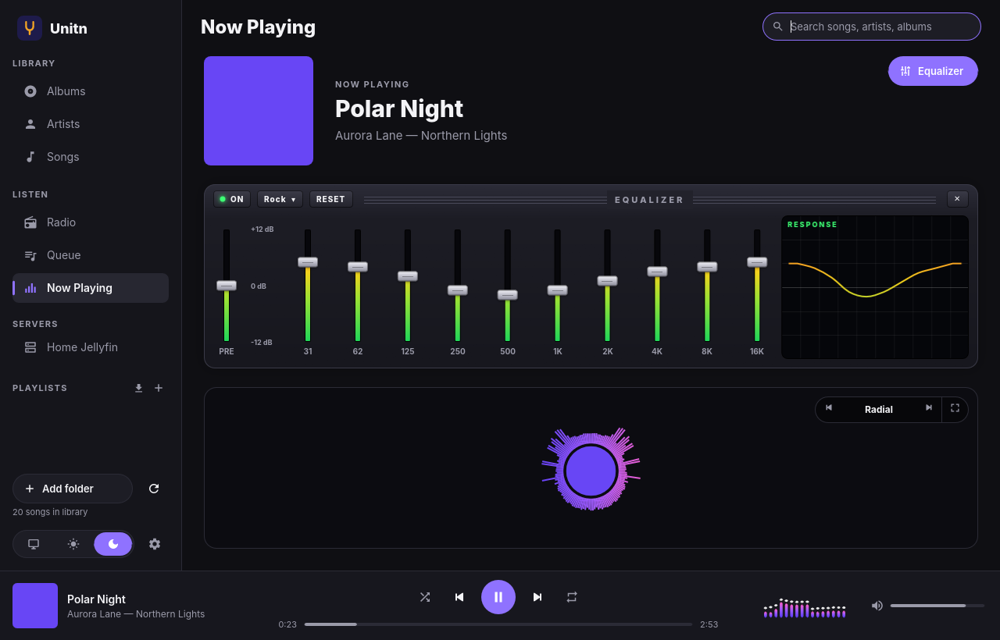
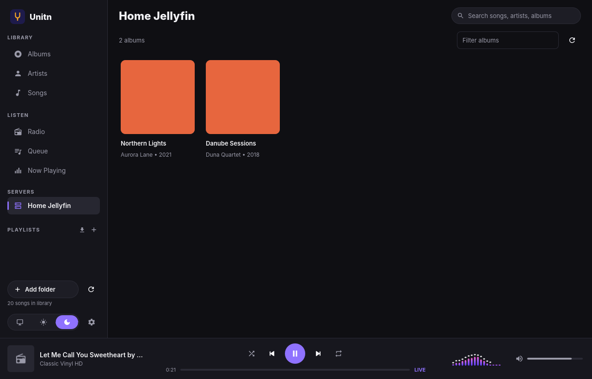
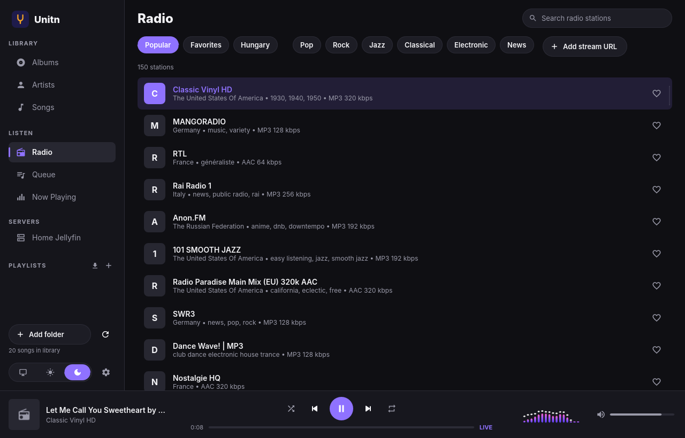
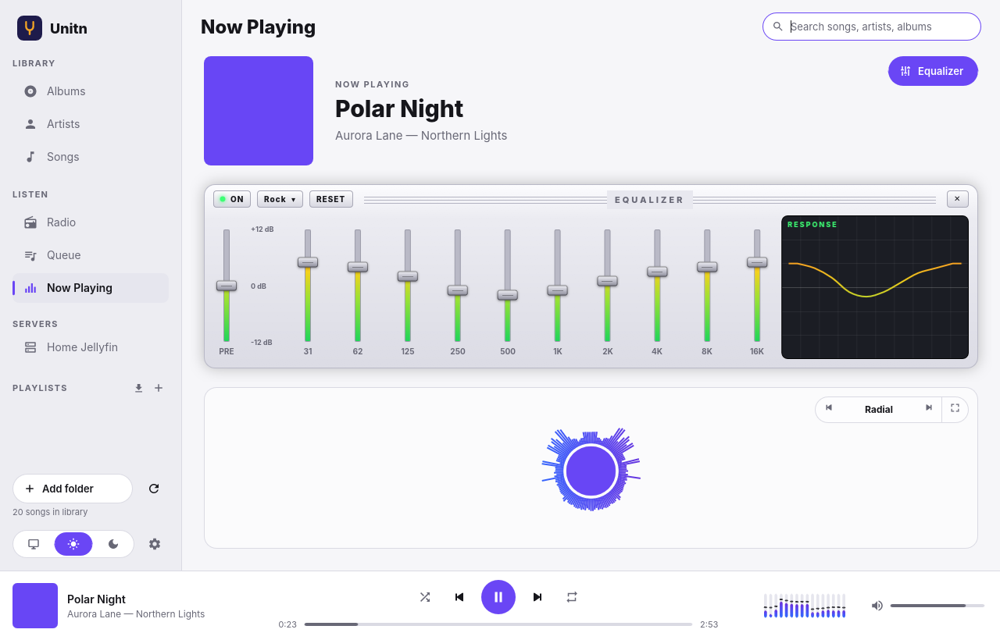
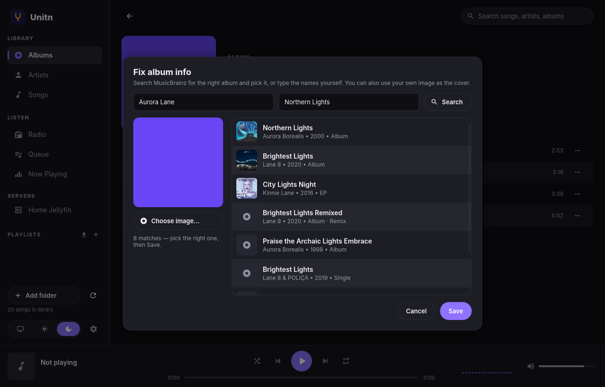
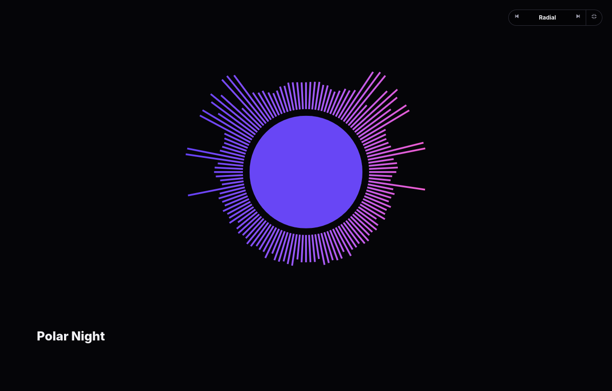
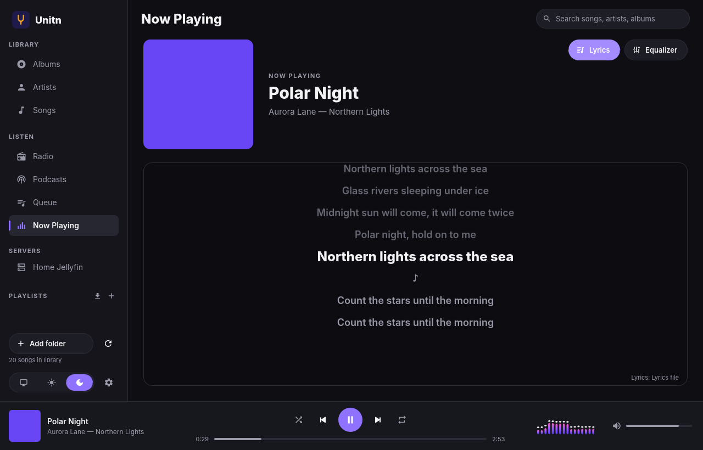
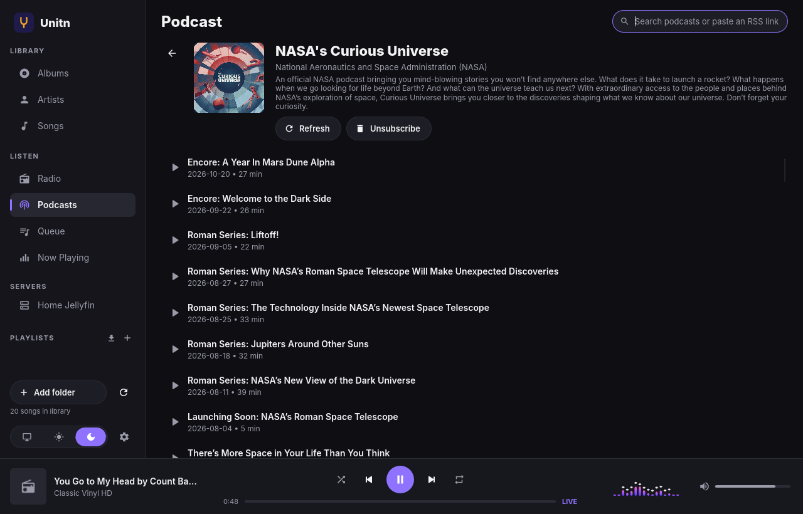

# Unitn player

**Unitn player** (say "unitone player") is a free, open-source music player for
**Windows, macOS and Linux**, written in Rust. Think "VLC for music", with a
modern UI: your local music library, your **Jellyfin, Plex and Navidrome** servers,
thousands of internet radio stations and your **podcasts**, in one fast app with no ads,
no account and no tracking.

**Website and downloads: [unitn.bokors.net](https://unitn.bokors.net)**

> Status: v0.6.0 — young but usable. Feedback and contributions welcome.



| Now Playing with the Winamp-style equalizer | Your music server |
|---|---|
|  |  |
| **Internet radio** | **Light theme** |
|  |  |
| **Fix album info** (MusicBrainz) | **Full-screen visualizer** |
|  |  |
| **Synced lyrics** | **Podcasts** |
|  |  |

## Features

- **Local library**: scans your music folders (MP3, FLAC, AAC/M4A, ALAC, OGG Vorbis, WAV, AIFF),
  reading tags and embedded or folder cover art
- **Albums, Artists and Songs** views with instant search, Apple-style striped track lists,
  Comfy and Cozy list density, and a play marker on the current song
- **Album art**: missing covers are downloaded from the free MusicBrainz / Cover Art Archive,
  and artist photos (from Wikimedia Commons) appear behind Now Playing
- **Fix album info**: search MusicBrainz by hand, pick the right album and cover (or use your
  own image) and correct artist/album names. Your music files are never modified
- **Music servers**: Jellyfin, Plex, Navidrome and other OpenSubsonic servers. Browse your
  server's albums (with covers) and play them like local music — seeking and gapless included.
  Search finds songs on your servers too, and server songs can go into playlists.
  See [Music servers](#music-servers)
- **Podcasts**: search Apple's public podcast directory or paste any RSS link, subscribe, and
  play episodes. Unitn remembers where you stopped in each episode and shows what's new
- **Lyrics** on Now Playing: synced lyrics scroll along with the song and highlight the current
  line. They come from a `.lrc` file next to the song, from the song's own tags, or online from
  the free [LRCLIB](https://lrclib.net) (can be turned off)
- **Internet radio** with ~50,000 stations from the open [Radio Browser](https://www.radio-browser.info),
  Popular / Favorites / Hungary tabs and your own stream URLs
- **Playlists**: create, rename, reorder, import/export M3U, and save the queue as a playlist;
  local songs and songs from your servers can be mixed
- **Queue** with drag-to-reorder, shuffle, repeat all / repeat one
- **Gapless playback** and **crossfade** (2–12 s; optionally keep songs of the same album gapless), and
  whole-file preloading so music from network shares doesn't stutter
- **Winamp-style 10-band equalizer** with preamp, presets and a live response curve
- **Visualizer** with five styles (spectrum with falling bars, mirror, wave, oscilloscope, radial),
  tuned for both themes; the ‹ › buttons (or ← →) switch styles and a button goes full screen. The
  buttons appear when you move the mouse and fade out when it rests
- **Drag & drop** files, folders and M3U playlists onto the window
- **Keyboard shortcuts** (Space, ←/→ seek, ⌘/Ctrl+←/→ track, ↑/↓ volume, ⌘/Ctrl+F search …)
- **Dark and light themes**, or follow the system setting; adjustable window transparency and,
  on macOS, a frosted-glass (blurred) window background
- **Media keys and OS integration**: macOS Now Playing, Windows media overlay, Linux MPRIS
- Native Rust audio engine (symphonia + cpal), with no web view and no Electron

## Download

Get the latest installers from the **[Releases page](https://github.com/boka89/Unitn/releases/latest)**:

- **Windows**: `…_x64-setup.exe` installer, or the portable `.zip`
- **macOS**: `…_aarch64.dmg` (Apple Silicon) or `…_x64.dmg` (Intel)
- **Linux**: `.deb` (Debian/Ubuntu), `.AppImage` (any distro) or portable `.tar.gz`

The builds are not signed with paid certificates yet. On macOS, open the app the first time with
right-click → Open (or System Settings → Privacy & Security → "Open Anyway").

## Music servers

Unitn plays the music on your own **Jellyfin**, **Plex** or **Navidrome** server (or any other
OpenSubsonic / Subsonic server, such as Gonic or Airsonic). Open
**Settings → Music servers → Add server**:

| | Jellyfin | Plex | Navidrome / Subsonic |
|---|---|---|---|
| Address | `192.168.1.10` (port 8096 is assumed) or the full URL, e.g. `https://music.example.com` | optional: leave it empty and Unitn finds your server, or type `192.168.1.10` (port 32400 is assumed) or the full URL | `192.168.1.10` (port 4533 is assumed) or the full URL |
| Sign in | your Jellyfin user name and password | click **Sign in with Plex**: plex.tv opens in your browser, you sign in there (two-factor sign-in works), and Unitn picks up the access token. If no browser opens, go to [plex.tv/link](https://plex.tv/link) and enter the code Unitn shows | your user name and password |

The server then appears under **SERVERS** in the sidebar. Its albums open in the normal album
view; play, shuffle, queue and "play next" work as for local music. The search box at the top
also finds songs on all your servers (they are listed below your own songs), and any server
song can be added to a playlist, next to your local music.

Good to know:

- Songs are streamed as the **original files** (no transcoding) and loaded into memory in the
  background, so seeking is instant and albums play gaplessly. Formats Unitn can't decode
  (e.g. Opus, WMA) won't play yet.
- Unitn never sees your Plex password, and only uses your Jellyfin password to sign in. It stores
  the **access token** the server gives it (in `settings.json`, see below); for Subsonic servers a
  salted token (`md5(password + salt)`) instead of the password. Remove the server in
  Settings to forget it; you can also revoke the device under Jellyfin's Dashboard → Devices or
  Plex's Settings → Authorized Devices.
- HTTPS works with properly signed certificates; for self-signed certificates use the server's
  `http://` LAN address.
- Server songs can't be added to playlists yet.

## Making a release

Releases are fully automated by [`.github/workflows/release.yml`](.github/workflows/release.yml):

1. Bump `version` in the root `Cargo.toml` (and in `Cargo.lock`), and commit.
2. On GitHub open **Actions → Release → Run workflow** and enter the version, e.g. `0.4.0`
   (or push a tag `v0.4.0`).
3. GitHub Actions builds every installer and publishes the release with notes.

Every push is built and tested on all three systems by
[`build.yml`](.github/workflows/build.yml): unit tests, a playback smoke test on macOS
(files, radio, gapless), a radio stream check, a Windows startup test, real **Jellyfin and
Plex servers in Docker** that Unitn signs in to and streams from, and the screenshots
above (published to the `ci-screenshots` branch).

To test the packaging without publishing, run the **Release** workflow manually from the Actions tab.

## Building from source

Install Rust (<https://rustup.rs>), then:

```sh
git clone https://github.com/boka89/Unitn
cd Unitn
cargo run --release
```

On **Linux** you also need the ALSA and font/keyboard development packages:

```sh
# Debian / Ubuntu
sudo apt install libasound2-dev libfontconfig1-dev libxkbcommon-dev
# Fedora
sudo dnf install alsa-lib-devel fontconfig-devel libxkbcommon-devel
```

Windows and macOS need no extra packages.

## Project layout

```
crates/
  unitn-core/   audio engine, library index (SQLite), radio client (no UI code)
    src/audio/       decoding (symphonia), output (cpal), HTTP/ICY radio streams
    src/library/     folder scanner (lofty tags) + SQLite database
    src/radio.rs     Radio Browser API client
    src/servers.rs   Jellyfin and Plex clients
    src/artwork.rs   album art and artist photos (MusicBrainz, Cover Art Archive, Wikimedia)
  unitn/        the desktop app (Slint UI)
    ui/              .slint files: theme, widgets, pages, main window, icons
    src/app.rs       app state: queue, playback, library and radio wiring
    src/media.rs     media keys / OS now-playing integration (souvlaki)
    src/glass.rs     macOS frosted-glass window background
```

The UI is written in [Slint](https://slint.dev). To tweak the design with live
preview, install the Slint VS Code extension or `slint-viewer` and open
`crates/unitn/ui/app.slint`.

## Where data is stored

| OS      | Library database & covers                         | Settings                                 |
|---------|---------------------------------------------------|------------------------------------------|
| Linux   | `~/.local/share/unitn/`                           | `~/.config/unitn/settings.json`          |
| macOS   | `~/Library/Application Support/net.bokors.Unitn/` | same folder                              |
| Windows | `%APPDATA%\bokors\Unitn\data\`                   | `%APPDATA%\bokors\Unitn\config\`        |

On first start, your system Music folder is added automatically.

## Roadmap

- High-quality resampler, ReplayGain
- Podcast downloads for offline listening
- HLS radio streams, full-quality HE-AAC, Opus

## License

GPL-3.0-or-later. Icons are based on Google's Material Icons (Apache-2.0).
